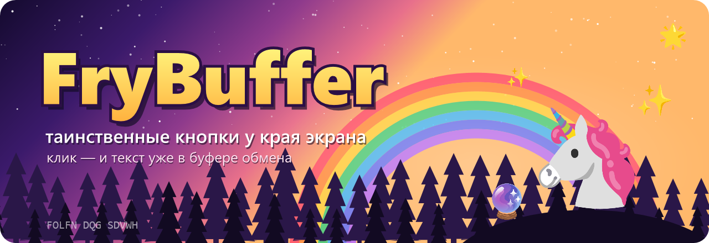
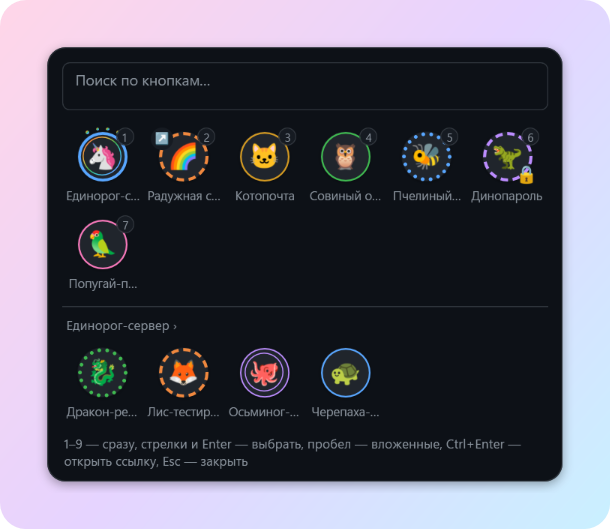
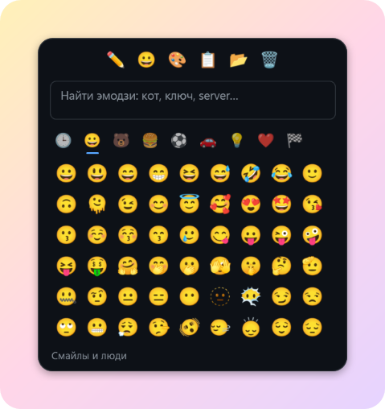
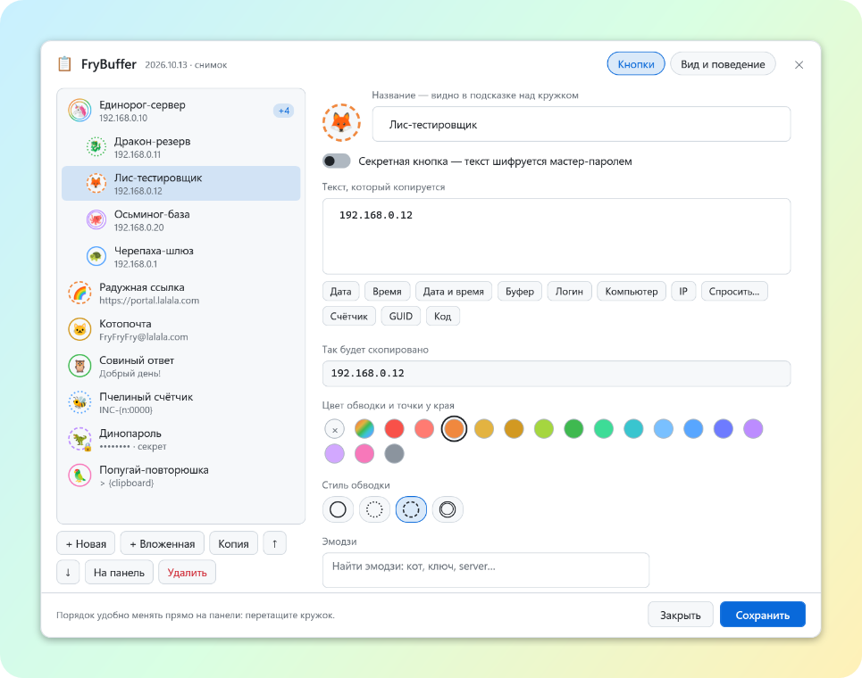
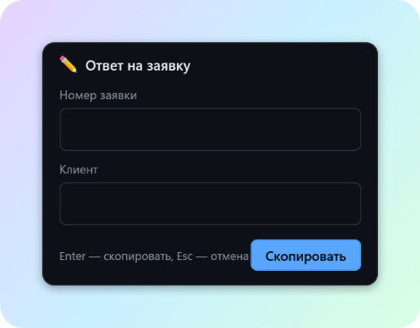
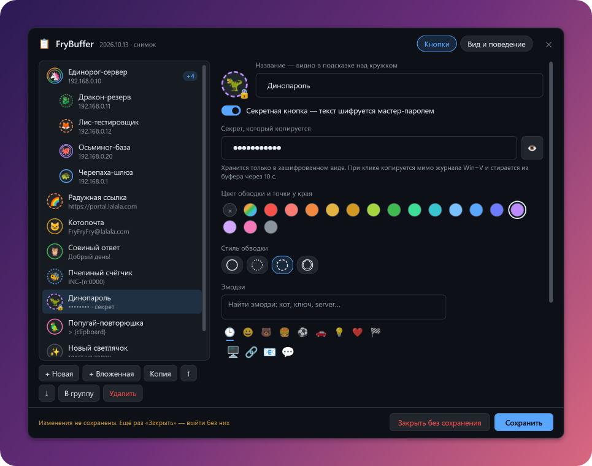
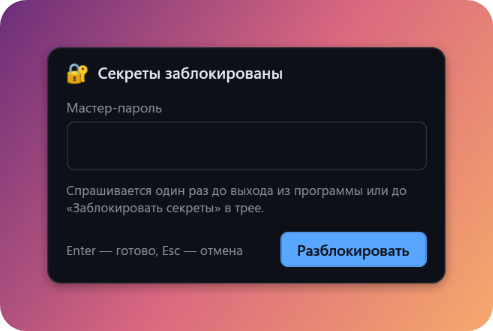

<p align="center">
  
</p>

<p align="center">
  <a href="https://github.com/LavabangaFry/FryBuffer/releases/latest"></a>
  
  
  
</p>

<h3 align="center">🌲 Дневник странностей, запись №1: у края экрана живут светлячки 🌲</h3>

> *Они сидят внизу экрана — маленькие, разноцветные, почти незаметные.
> Стоит поднести к ним мышь, и они разлетаются кругами, а внутри каждого —
> эмодзи. Ткнёшь в круг — и в буфере обмена уже лежит нужный текст.
> Учёные называют это «экономией времени». Я называю это магией.* 🦄

<p align="center">
  
</p>

## 🌈 Что это за штуковина?

**FryBuffer** — это кнопки-эмодзи для текста, который вы набираете по сто
раз на дню: IP-адреса, почту, ссылки, «Добрый день, заявка принята…».

Никаких окон и меню на пути. Точки у края → кружок → клик → **Ctrl+V**.
Всё. Можно идти пить какао. ☕

## ✨ Семь чудес FryBuffer

| | Чудо | Как это выглядит |
|---|---|---|
| 🔮 | **Светлячки у края** | В покое — цветные точки. Мышь рядом — точки волной раскрываются в кружки |
| 🦄 | **Веер, как в играх** | Задержи мышь на кружке — вокруг дугой раскроются вложенные: основной сервер, резервный, тестовый |
| ⌨️ | **Win+Alt+V** | Все кнопки сеткой прямо у курсора. Нажал цифру — скопировано, фокус вернулся, жми Ctrl+V. Есть ссылка — ↗ откроет её в браузере |
| 🧙 | **Шаблоны-заклинания** | `{date}`, `{user}`, `{n}`, `{rand:12}`, а `{?Номер заявки}` спросит номер прямо при клике |
| 🌟 | **1340 цветных эмодзи** | Выбор как на телефоне: вкладки и поиск по-русски — «кот», «ключ», «сервер» |
| 🎨 | **Радужные обводки** | 18 цветов, включая настоящую радугу, и четыре стиля: сплошная, точками, тире, двойная |
| 🔐 | **Тайник для паролей** | Секретные кнопки под мастер-паролем: в файле только шифр, в буфере — 10 секунд и мимо журнала Win+V |

## 🐾 Зоопарк по умолчанию

С первого запуска у края живут семь зверей — и их цвета идут по радуге,
так что в покое точки у края складываются в маленькую радугу 🌈:

🦄 **Единорог-сервер** (а в его веере 🐉 дракон, 🦊 лис, 🐙 осьминог и 🐢 черепаха) ·
🌈 **Радужная ссылка** · 🐱 **Котопочта** · 🦉 **Совиный ответ** с вопросом про номер заявки ·
🐝 **Пчелиный счётчик** · 🦖 **Динопароль** · 🦜 **Попугай-повторюшка**, который повторяет буфер обмена.

Каждый зверь показывает одно умение — поиграй с ними, а потом заведи своих.

## 🖼️ Немного картинок из дневника

<table>
  <tr>
    <td align="center"><br><sub><b>Win+Alt+V</b> — сетка у курсора, вложенные отдельным рядом</sub></td>
    <td align="center"><br><sub>Правый клик по кружку → 😀 — эмодзи как на телефоне</sub></td>
  </tr>
  <tr>
    <td align="center"><br><sub>Настройки: дерево кнопок и «так будет скопировано»</sub></td>
    <td align="center"><br><sub><code>{?Номер заявки}</code> спрашивает при клике</sub></td>
  </tr>
</table>

## 🔐 Тайник для паролей

> *Запись №2: некоторые светлячки носят крошечные замочки. Что внутри —
> не видно никому, пока не прошепчешь мастер-пароль.* 🗝️

Включи у кнопки «Секретная кнопка» — и её текст зашифруется:

- 🔑 **Мастер-пароль** придумываешь сам, при первой секретной кнопке. Он нигде не хранится — даже у FryBuffer. Забудешь — секреты не вернуть, так что запиши его на бумажке и спрячь под единорога. 🦄
- 🕯️ **Один раз за сеанс**: пароль спрашивается при первом клике по секрету, а «Заблокировать секреты» в трее снова всё закрывает.
- ⏳ **10 секунд** пароль живёт в буфере, потом исчезает. В журнал Win+V и облачный буфер Windows он не попадает вовсе.
- 🙈 **Никаких подглядываний**: в подсказке `••••••••`, на кружке 🔒, в настройках звёздочки и 👁 — показать, пока держишь.
- 🧪 **Под капотом**: AES-256 + HMAC-SHA256, ключ из мастер-пароля через PBKDF2-SHA256 (150 000 итераций). Чужой пароль или испорченный файл — честная ошибка, а не мусор в буфере.

<table>
  <tr>
    <td align="center"><br><sub>Секрет в настройках: звёздочки, 👁 и замочек на кружке</sub></td>
    <td align="center"><br><sub>Мастер-пароль — один раз за сеанс</sub></td>
  </tr>
</table>

## 🪄 Заклинания (шаблоны)

Пишешь в тексте кнопки — при клике подставляется само:

| Заклинание | Что призывает |
|---|---|
| `{date}` · `{time}` · `{now}` | Сегодняшнюю дату, время или всё сразу. Свой формат: `{now:dd MMMM, HH:mm}` |
| `{clipboard}` | То, что лежит в буфере прямо сейчас |
| `{user}` · `{computer}` · `{ip}` | Твой логин, имя компьютера, адрес в сети |
| `{?Вопрос}` | Спросит при клике и подставит ответ |
| `{n}` · `{n:0000}` | Счётчик, сам растёт с каждым кликом: `INC-0042` |
| `{guid}` · `{rand:12}` | Свежий GUID или случайный код без путаницы `0/O` и `1/l` |

Пример древнего свитка:

```
Добрый день!
Заявка {?Номер заявки} принята в работу {date} в {time}.
С уважением, {user}
```

## 🏕️ Как приручить

1. Скачай **`FryBuffer.exe`** из [Releases](https://github.com/LavabangaFry/FryBuffer/releases/latest).
2. Положи куда угодно и запусти. Установки нет, интернет не нужен.
3. Подведи мышь к цветным точкам у нижнего края. Они уже знают, что делать. 🌈
4. Свои кнопки — правый клик по значку в трее → **«Настройки…»**.
5. Чтобы светлячки просыпались вместе с Windows — трей → **«Запускать вместе с Windows»** ✅.

Новая версия? Просто запусти новый exe — старый сам уступит место, а внизу
всплывёт «FryBuffer обновлён». Версия видна первой строкой в меню трея.

> 🛡️ exe не подписан цифровой подписью, поэтому SmartScreen может
> поворчать: «Подробнее» → «Выполнить в любом случае». Не доверяешь
> единорогам — собери сам, см. ниже.

## 🔧 Собрать самому

Нужна только Windows 10/11: PowerShell 5.1 и компилятор .NET уже внутри.

```
git clone https://github.com/LavabangaFry/FryBuffer.git
cd FryBuffer
powershell -NoProfile -ExecutionPolicy Bypass -File tools\build-exe.ps1
```

Сборка покажет по шагам, что происходит, и положит рядом `FryBuffer.exe`.
Без сборки можно запустить прямо из папки: `FryBuffer.vbs`.

Тесты: `powershell -NoProfile -File tests\run-tests.ps1`

Всё подробно — настройки, `config.json`, «симптом → что делать» — в
[руководстве](docs/MANUAL.md).

## 🧩 Загадка для внимательных

В углу шапки есть строчка `FOLFN DQG SDVWH`. Это шифр. Подсказка: каждая
буква сдвинута на **три** вперёд по алфавиту. Разгадал — значит, ты уже
понял, как пользоваться FryBuffer. 🔍

## 📜 Лицензия и благодарности

- Код — [MIT](LICENSE): бери, пользуйся, переделывай, только оставь упоминание автора.
- Эмодзи — [Noto Color Emoji](https://github.com/googlefonts/noto-emoji) от Google (Apache 2.0),
  набор и категории — [emoji-datasource](https://github.com/iamcal/emoji-data) (MIT),
  русские названия для поиска — [Unicode CLDR](https://cldr.unicode.org/).

<p align="center"><sub>Сделано с 🦄 и 🌈 · не забывай пить какао</sub></p>
